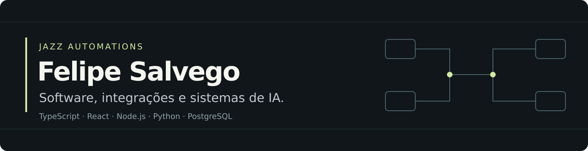

[Jazz Automations](https://jazzautomations.com.br) · [LinkedIn](https://www.linkedin.com/in/felipesalvego/) · [Naima](https://naima.com.br) · [MasterSinger](https://www.mastersinger.com.br)

**Sou Felipe Salvego, desenvolvedor full stack e fundador da Jazz Automations.** Construo aplicações completas: arquitetura, banco de dados, APIs, interfaces, integrações e sistemas de IA. Trabalho com desenvolvimento orientado por agentes, revisão de código e verificação das entregas.

## Projetos em destaque

| Projeto | O que construí | O trabalho de engenharia |
| :--- | :--- | :--- |
| **[MasterSinger](https://www.mastersinger.com.br)** | Aplicação de prática musical com feedback de afinação no navegador. | Captura e processamento de áudio, frequência, ruído, harmônicos, suavização e ciclo de vida do microfone. O detector possui testes com sinais harmônicos e tolerância em cents. |
| **[Naima](https://naima.com.br)** | Produto para atendimento, agendamento e gestão de salões. | Interface, regras de negócio, dados e integrações reunidos em torno da rotina de uma operação. |
| **[Vetra Auditor](https://vetra-pitch.vercel.app)** | Projeto da equipe campeã do Hackathon Runflow + Oracle. | Agente de auditoria de CRM com citações verificadas contra os documentos de origem: normalização, comparação, correção e descarte de evidências sem sustentação. |

O Vetra foi desenvolvido em equipe. As 100 oportunidades auditadas pertencem ao cenário do hackathon. Os links acima levam aos produtos e à apresentação do projeto.

## Como trabalho

- **Do problema à especificação:** entender a operação, definir regras de negócio e o comportamento esperado do sistema.
- **Da arquitetura à aplicação:** conectar frontend, backend, dados, APIs e infraestrutura.
- **Desenvolvimento com agentes:** organizar contexto, dividir a implementação, revisar as entregas e conferir o resultado com testes.
- **Operação e acompanhamento:** logs, rastreabilidade, tratamento de falhas e intervenção humana nos pontos críticos.

| Área | Tecnologias e práticas |
| :--- | :--- |
| Interfaces | TypeScript, JavaScript, React, Next.js |
| Backend e dados | Node.js, Python, PostgreSQL, APIs e integrações |
| IA e agentes | Orquestração, contexto, verificação de evidências e aprovação humana |
| Áudio e qualidade | Web Audio, testes automatizados, tratamento de ruído e observabilidade |

## Hackathons e mentoria

- **Runflow + Oracle:** integrante da equipe campeã com o Vetra Auditor, em 2026.
- **OpenAI Brasil e Yuno + Nauta:** participação nos hackathons. No NextWave, trabalhei em equipe no desafio de interfaces que se adaptam ao fluxo e ao estado de uma operação logística.
- **Hack Inova AI — UNIFACENS, Sorocaba:** mentor no evento com patrocínio da Oracle. Preparei o guia público **[Do Zero ao Ar](https://hackinova.vercel.app)** para apoiar as equipes na configuração do ambiente e publicação de demonstrações.

## Código público

**[secure-code-skill](https://github.com/jazzautomations/secure-code-skill)** — material e verificações para apoiar a revisão de segurança no desenvolvimento com agentes de IA, com atenção a evidências e falsos positivos.

O Secure Code Skill reúne o código aberto que compartilho aqui. Naima e MasterSinger são apresentados pelos links dos produtos; seus repositórios permanecem privados.

## Software sob demanda e consultoria

Pela **Jazz Automations**, desenvolvo sistemas internos, integrações e agentes de IA, além de consultoria técnica e de processos. O objetivo é reduzir retrabalho e custos, ganhar tempo, organizar os dados e dar mais visibilidade e controle à operação.

Precisa construir um sistema ou conectar as ferramentas do seu negócio? **[Conheça a Jazz](https://jazzautomations.com.br)** ou **[converse comigo no LinkedIn](https://www.linkedin.com/in/felipesalvego/)**.
